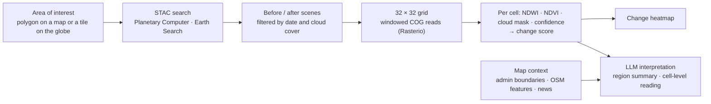

# Tracefield

**Turn free satellite imagery into region-level change you can read cell by cell.**

Tracefield is a geospatial AI workspace for regional change analysis. Pick an area, choose a before and an after Sentinel-2 scene, and it splits the region into a grid, scores how water and vegetation changed in every cell, adds the map context around it, and lets an LLM explain what it sees.

> [!NOTE]
> This repository is a project showcase. The source code is private; a walkthrough is available on request.

  <video src="https://github.com/user-attachments/assets/ec08e786-72dd-400c-92d2-d29ce03058e7" width="100%" controls autoplay loop muted></video>

## Why

Comparing an old street view with today's is oddly absorbing: you see what a place looked like before the construction. Tracefield takes that idea to city scale. ESA publishes Sentinel-2 multispectral imagery for free every few days at 10 m resolution, and public geodata is plentiful, but turning two scenes into a readable answer still takes a GIS analyst. Tracefield makes the comparison, the numbers and a first interpretation available in one workspace.

## How it works

1. **Find scenes.** Draw a polygon on a MapLibre map, or click a Sentinel-2 tile on a 3D globe. The API queries Microsoft Planetary Computer or AWS Earth Search over STAC and returns candidate scenes from 2015 onward, filtered by year, month and cloud cover.
2. **Compare.** Pick a before and an after scene and slide between them.
3. **Measure.** The region is split into a 32 × 32 grid. Cloud-Optimized GeoTIFFs are read only for the window needed, so nothing is downloaded in full. Each cell gets NDWI (water) and NDVI (vegetation) for both dates, and the difference becomes a change score. Cloudy pixels are masked with the scene classification band and lower the cell's confidence.
4. **Add context.** Numbers alone can't tell a riverbank from a parking lot, so each cell is annotated with administrative boundaries (KOSTAT for Korea) and nearby OpenStreetMap features such as rivers, buildings and highways. GDELT news for the area and period is attached as reference.
5. **Interpret.** The LLM produces a structured summary of the whole region, and clicking any cell sends just that cell's deltas, cloud ratio and nearby features for a focused reading, for example a rise in water index next to a named stream.

## Features

- Before/after Sentinel-2 scene comparison with a slider
- Grid-based change analysis with a heatmap of change scores
- NDWI, NDVI, cloud masking and per-cell confidence
- Administrative boundary and OpenStreetMap context for every cell
- 3D globe with tile presets for quick scene search
- Region-level and cell-level AI interpretation
- Guardrails against overclaiming: outputs avoid phrases like "confirmed damage," and every report carries a disclaimer

## Tech stack

| Area | Stack |
|---|---|
| Frontend | Next.js, React, MapLibre GL, Three.js (react-globe.gl) |
| Backend | FastAPI, Rasterio, NumPy, Shapely |
| Data | Sentinel-2 L2A via STAC (Planetary Computer, Earth Search), KOSTAT boundaries, OpenStreetMap, GDELT |
| AI | OpenAI Responses API |
| Deployment | Docker Compose, Caddy |

## Notes

Results are observational aids. Clouds and seasonal differences between the two scenes can skew the reading, and the analysis must not be used as an official damage, legal or safety determination.

---

Built by [Yoo Heehyeon](https://hhkb.dev) at [Intbox](https://intbox.org).
